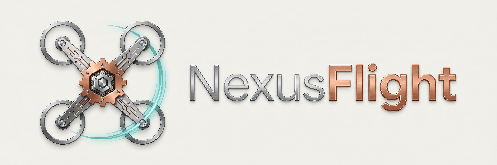
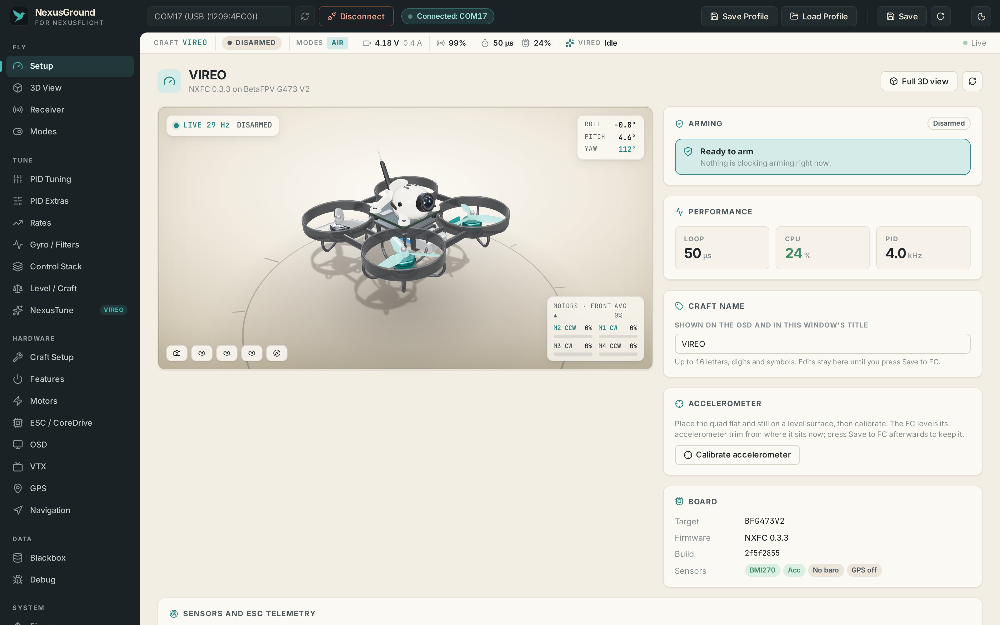
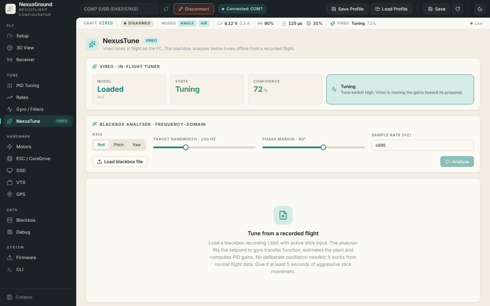
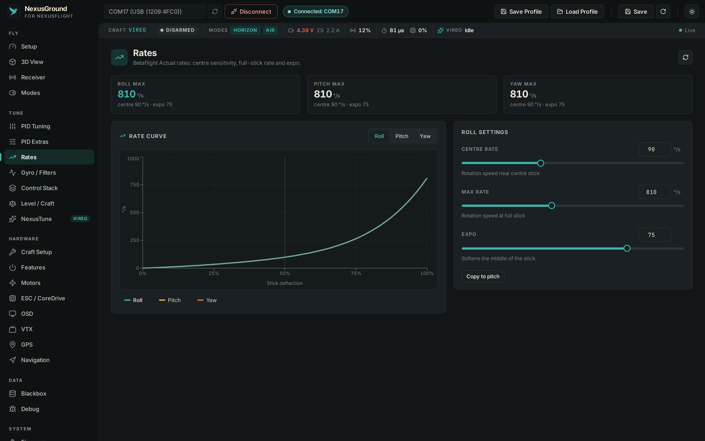

<p align="center">
  
</p>

<h1 align="center">NexusFlight Suite</h1>

<p align="center">
  <strong>A flight controller ecosystem built together with its own ESC firmware: NexusFlight FC firmware and CoreDrive ESC firmware, configured from one app, with in-flight AI tuning by Vireo, an Oxiryn-trained model</strong>
</p>

<p align="center">
  <a href="https://github.com/AutomataNexus/NexusFlight-Suite/releases"></a>
  &nbsp;
  <a href="https://github.com/AutomataNexus/NexusFlight-Suite/releases"></a>
  &nbsp;
  <a href="https://github.com/AutomataNexus/NexusFlight-Suite/blob/main/LICENSE"></a>
</p>

<p align="center">
  <a href="https://NexusFlight.AutomataNexus.com"></a>
  &nbsp;
  
  &nbsp;
  
  &nbsp;
  
  &nbsp;
  
  &nbsp;
  <a href="#request-source-access"></a>
</p>

<p align="center">
  
  &nbsp;
  
  &nbsp;
  
  &nbsp;
  
  &nbsp;
  
  &nbsp;
  
  &nbsp;
  
  &nbsp;
  
  &nbsp;
  
  &nbsp;
  
</p>

<br/>

<p align="center">
  <a href="#-currently-developing-betafpv-air65-ii">Air65 II</a> &nbsp;&bull;&nbsp;
  <a href="#project-status">Status</a> &nbsp;&bull;&nbsp;
  <a href="#known-issues">Known Issues</a> &nbsp;&bull;&nbsp;
  <a href="#nexustune--in-flight-ai-tuning">NexusTune &amp; Vireo</a> &nbsp;&bull;&nbsp;
  <a href="#blackbox-on-the-flash-chip">Blackbox</a> &nbsp;&bull;&nbsp;
  <a href="#nexusground-configurator">NexusGround</a> &nbsp;&bull;&nbsp;
  <a href="#coredrive--field-oriented-control">CoreDrive</a> &nbsp;&bull;&nbsp;
  <a href="#downloads">Downloads</a> &nbsp;&bull;&nbsp;
  <a href="docs/GETTING_STARTED.md">Getting Started</a> &nbsp;&bull;&nbsp;
  <a href="docs/SUPPORTED_HARDWARE.md">Hardware</a> &nbsp;&bull;&nbsp;
  <a href="https://NexusFlight.AutomataNexus.com">Website</a>
</p>

---

## 📌 Currently Developing: BETAFPV Air65 II

<p align="center">
  
  &nbsp;
  
  &nbsp;
  
  &nbsp;
  
</p>

> **NexusFlight has flown.** On 23 November 2026 a BETAFPV Air65 II running a NexusFlight development build took its first flight, props on, and flew well through normal flying. It is not ready for anyone else to fly yet: during hard flips and a punch into a 180° turn the quad lost a motor or its receiver link and went down, and the cause is not known yet. The analog OSD does not show in the goggles yet either. See [Known Issues](#known-issues). The ESCs still run their stock Bluejay firmware; CoreDrive-8051 has only run in our simulator.

The Air65 II is a 65 mm 1S whoop. Its flight controller and ESCs sit on one AIO board, the **BETAFPV Matrix 1S 5IN1 II** (12A), which also carries the receiver, VTX, OSD and a 16 MB flash chip. That makes it a complete test of NexusFlight's "FC and ESC as one system" idea on a single board.

### The flight controller: Matrix 1S 5IN1 II (`betafpv_g473_v2`)

| | |
|---|---|
| **Betaflight target** | `BETAFPVG473_V2` |
| **MCU** | STM32G473CEU6 per BETAFPV's target (our boards read back as STM32G474), Cortex-M4F at 170 MHz, 8 MHz crystal |
| **Gyro** | Bosch **BMI270** on our boards, detected by NexusFlight on hardware and running at 3.2 kHz. BETAFPV ships this board with any of BMI270, ICM-42688-P, ICM-42622-P or LSM6DSK320X depending on batch, so NexusFlight detects the chip at boot and one image covers all four (only the BMI270 has been seen on real hardware) |
| **OSD** | AT7456E (MAX7456-compatible) analog OSD on SPI2. **Not working on hardware yet**, fix in progress |
| **Receiver** | Onboard serial ExpressLRS 2.4 GHz (CRSF on USART3). Flown with NexusFlight |
| **VTX** | Onboard analog 5.8 GHz VTX, 25 / 100 / 200 / 400 mW, SmartAudio on USART2. NexusFlight reads its band, channel and power on hardware |
| **Blackbox** | 16 MB SPI flash on SPI3, used by NexusFlight for blackbox logging |
| **Motors** | 4 outputs, all on TIM3 (PB0, PB1, PC6, PA4), DShot300 with bidirectional DShot |
| **NexusFlight target** | `betafpv_g473_v2`. Not the same as the first-revision `betafpv_g473` image, which uses different pins |

### Where it stands

**Seen working on hardware** (two Air65 II quads, on the bench and in one flight):

- Flashing over USB with no BOOT button: from stock Betaflight, and from NexusFlight itself, the FC reboots into its DFU bootloader on one MSP command (about 1.2 s), takes the image, and every flash is read back and checked before it is trusted.
- USB connection and MSP v2, BMI270 detection at 3.2 kHz, attitude, SmartAudio reading the VTX, and the 16 MB blackbox flash chip (detected, erased, and read back).
- DShot motor output, arming and the ELRS receiver: the quad flew, hovered and handled normal flying well.
- Our pilot's own Betaflight tune, ported as the board's defaults: Betaflight motor order, -135° board alignment, props out, Actual rates, his PIDs and throttle curve, and his switch layout.

**Built and simulator-tested, not yet confirmed on hardware:** the analog OSD (no picture in the goggles yet), angle and horizon self-levelling, turtle mode, beeper, VTX pit mode, the RPM filter and dynamic notch (they rely on bidirectional DShot eRPM, which is not yet confirmed on hardware), CRSF telemetry back to the radio, the current sensor, the post-flight stats screen, blackbox writes in flight, the fast blackbox download on a full chip, and the Vireo in-flight tuner.

**Flight features in the Air65 II image**, ported from Betaflight so it flies like the stock quad: angle and horizon modes, turtle (flip over after crash), beeper and DShot beacons, VTX pit-mode switch, RPM filter (12 poles), dynamic notch, TPA, anti-gravity, D-max, dynamic D lowpass, I-term relax, airmode, dynamic idle, feedforward jitter reduction, CRSF telemetry, the post-flight OSD stats screen, and the Vireo tuner on AUX5.

**Next on this board:** find the cause of the in-flight motor or receiver drop from a blackbox log, get the OSD showing in the goggles, confirm bidirectional DShot eRPM with the battery in, then more flights in ANGLE before anything aggressive. A **NexusFlight boot logo** for the OSD is coming once the OSD shows a picture.

### The ESCs: CoreDrive-8051 on the onboard 12A ESCs

| | |
|---|---|
| **ESC** | 4 × 1S 12A, on the same Matrix 5IN1 II board |
| **ESC MCU** | Silicon Labs **EFM8BB51** (8051 core), one per motor |
| **Stock firmware** | Bluejay 0.19.2, layout tag `#A_X_05#`, 96 kHz PWM |
| **CoreDrive build** | **CoreDrive-8051**, layout **A_X_05**, matching the board |

- CoreDrive-8051 is CoreDrive for 8-bit ESCs: C (SDCC) with an 8051 assembly commutation core, built on the Bluejay six-step design and FC-compatible with it (DShot300/600, bidirectional DShot with extended telemetry, same settings layout).
- In our whole-board ESC simulator (`efm8sim`) it passes all 19 test scenarios on each of the five common layouts A to E, including standstill starts straight into 30% and 100% throttle.
- All four stock ESCs on our Air65 II have been backed up read-only through the flight controller, so the stock Bluejay image can be restored exactly.
- **Status: sim-tested only, never flashed to a real ESC.** ESC work is on hold until the flight controller side is solid. The first NexusFlight flight was flown on the stock Bluejay ESCs.

---

## Project Status

> **NexusFlight is pre-beta. It has flown once, on one board.**
>
> Every NexusFlight and CoreDrive target compiles and passes its host test suite, and every image is started in our boot simulator before it goes near a board. **One board, the BETAFPV Air65 II, has flown on NexusFlight**, and that flight ended in a crash whose cause we are still tracing. No other board has flown. Until a board is listed as flight-proven, treat its firmware as experimental: keep a backup of the stock firmware, and do not fly it.

| Piece | Version | State |
|-------|---------|-------|
| NexusFlight FC firmware | v0.3.3 release; development builds since | 30 board targets build (29 released plus the Air65 II). **First flight on the Air65 II** on 2026-11-23. No other board has flown. |
| BETAFPV Air65 II (`betafpv_g473_v2`) | **currently developing** | Flashed and flown. Bench-verified: USB, MSP, gyro, receiver, motors, VTX readout, blackbox chip, reboot-to-DFU with no button. Open: OSD not showing, one unexplained motor or receiver drop under hard flips. See [Air65 II](#-currently-developing-betafpv-air65-ii). |
| Vireo in-flight tuner (NexusTune) | Vireo v8, in the Air65 II build | Runs on the FC only with AUX5 high, at a 0.5 confidence gate, under the safety supervisor. Simulator-tested. **Not yet evaluated in flight.** See [NexusTune](#nexustune--in-flight-ai-tuning). |
| Blackbox | in the Air65 II build | Records to the board's 16 MB flash at 1 kHz, with a fast streaming download. Chip detection, erase and readback verified on hardware; in-flight logging not yet confirmed. See [Blackbox](#blackbox-on-the-flash-chip). |
| NexusGround configurator | v0.4.3 release; redesign in development | Released v0.4.3 installers for Windows and Linux. The **teal, graphite and cream redesign** runs on Windows as a development build; not yet released. See [NexusGround](#nexusground-configurator). |
| CoreDrive FOC ESC firmware (32-bit) | v0.3.2 | 245 ESC board configs, 4 MCU families. Host-tested, not yet run on a real ESC. |
| CoreDrive-8051 (8-bit EFM8BB51) | in development, on hold | Target: the Air65 II's 12A ESCs (layout A_X_05). 19 of 19 simulator scenarios pass on layouts A to E. Stock ESCs backed up. Never flashed. |
| Oxiryn (ML framework) | onboard | Trains Vireo and exports the int8 weights the FC runs. Runs on the training machine, not on the aircraft. |
| T-Motor F411 AIO | parked | Bench bring-up paused; the board needs one manual entry into its ROM bootloader to take a fixed image. |

### What's new since v0.3.3

- **First flight on the BETAFPV Air65 II**: NexusFlight flashed, armed and flown on a 65 mm whoop, using our pilot's own Betaflight tune ported as defaults.
- **Air65 II flight features**: angle and horizon, turtle, beeper and DShot beacons, VTX pit mode, RPM filter, dynamic notch, TPA, anti-gravity, D-max, I-term relax, dynamic idle, feedforward jitter reduction, CRSF telemetry and the post-flight stats screen.
- **Vireo v8 onboard**: the Oxiryn-trained Vireo model is compiled into the Air65 II build, gated on AUX5 and a 0.5 confidence floor, with every tuning step logged to the blackbox.
- **Blackbox on the 16 MB flash chip** with a **fast streaming download** that replaces a slow page-by-page read, and logging that stops after a failsafe landing so a quad left on USB power can't fill the chip.
- **NexusGround redesign** in teal, graphite and cream, now running on Windows, with a blackbox explorer that decodes the flash chip's logs and Vireo's tuning record, OSD layout read from and saved to the FC, a Vireo panel, an Actual-rates preview, and profiles that save without a database.
- **Reboot to DFU proven on hardware**: NexusFlight on the Air65 II drops into its USB bootloader on one MSP command, no button needed. An earlier image hung at this step; the fix (remapping system flash before jumping to the ROM bootloader, on G4 and F4) is now checked by the boot simulator for every image.
- **G4 fixes found on real hardware and in the simulator**: the STM32G473 target's DShot DMA request, DMA burst register address, ADC clock, 170 MHz boost mode and flash erase pages were each wrong in a way that would stop a real board. The first Air65 II battery test armed but no motor turned for exactly this reason. All fixed for every G473 board, and the boot simulator now checks them.
- **Boot simulator** extended: SPI flash with DMA and page programming, the G4 DMA burst registers, and a "battery plugged in after USB" start-up scenario.

---

## Known Issues

These are open on the Air65 II right now. None of them is fixed until a build with the fix has been flashed and checked on the board.

| Issue | State |
|---|---|
| **Motor or receiver drop under hard flips.** On the first flight, during flips and a hard punch into a 180° turn, the quad lost a motor or its receiver link and crashed. | **Cause unknown.** The flight was not logged: the flash chip had already been filled by failsafe logging while the board sat on USB power. That logging behaviour is fixed in the next build, and the next flight (in ANGLE, tuner off) will be logged and downloaded to find the cause. |
| **No OSD in the goggles.** Video comes through, but no OSD elements. | **Fix in progress.** The OSD chip on this board only powers up with the battery, and the first builds gave up looking for it before the battery was in; that was fixed, but the OSD still did not show. Newer builds retry with slower and different SPI modes and report exactly what the chip answers. Untested on hardware. |
| Betaflight Configurator does not connect (MSP v1). | NexusGround (MSP v2) works. Low priority. |
| The FC reports a 4 kHz loop to the configurator while it runs at the gyro's 3.2 kHz. | Cosmetic. |
| Analog OSD colours. | The AT7456E can only draw white text on a grey background. The teal, grey and cream OSD colours apply to NexusGround's OSD preview and to digital (DisplayPort) systems. |

---

## Why NexusFlight?

Every existing flight controller firmware (Betaflight, iNav, ArduPilot) treats the ESC as a black box. You flash the FC firmware, you flash the ESC firmware, and you hope they play nice together. The FC sends throttle commands over DShot and that's where its control ends.

**NexusFlight breaks that wall down.**

NexusFlight Suite ships **its own ESC firmware, CoreDrive**, alongside the FC firmware. The two are designed together and configured from the same app. On 32-bit ESCs, CoreDrive runs **integrated FOC (Field-Oriented Control)**: the flight controller doesn't just send throttle percentages, it shares the motor model, tunes the FOC loop, and reads real-time telemetry from every motor. On 8-bit whoop ESCs, CoreDrive-8051 brings the same "one system" approach to boards the 32-bit firmware can't run on.

To the best of our knowledge, no other flight controller software in the FPV drone ecosystem does this.

---

## What Sets NexusFlight Apart

NexusFlight goes beyond matching Betaflight feature-for-feature. These are capabilities that no other open-source flight controller firmware offers:

| Feature | Betaflight | NexusFlight |
|---------|-----------|-------------|
| **Gyro filtering** | Fixed-coefficient biquad chain | **Adaptive Kalman filter**: adjusts trust between prediction and measurement based on actual noise levels. Designed for less phase lag at equivalent noise rejection. |
| **Rate controller** | PID only | **ADRC (Active Disturbance Rejection Control)**: an Extended State Observer estimates and cancels total disturbance (wind, prop wash, weight changes) in real time. One tuning parameter instead of four. |
| **Gain scheduling** | TPA (linear D-term attenuation) | **Model-based gain scheduling**: scales all PID terms using thrust model curves and battery voltage compensation across the full flight envelope. |
| **Cross-axis coupling** | None | **Gyroscopic decoupling feedforward**: pre-compensates precession torques during yaw maneuvers. |
| **Auto-tune** | Manual tuning from blackbox logs | **Frequency-domain system identification**: estimates the plant transfer function from normal flight data via Welch's method. No deliberate oscillation needed. |
| **In-flight tuning** | None | **NexusTune with Vireo**: a small Oxiryn-trained neural network on the FC that adjusts PID gains while you fly, inside hard limits, under a safety supervisor. On board the Air65 II build; not yet proven in flight. |
| **Navigation** | None (that's iNav) | **9-state EKF**: GPS-IMU fusion with wind estimation, position hold, waypoint missions, wind-aware RTH. |
| **ESC integration** | DShot throttle commands | **Integrated ESC firmware**: FOC on 32-bit ESCs, CoreDrive-8051 on 8-bit ESCs, shared motor model, unified configuration. |
| **Brick protection** | Reboot to bootloader only from firmware that is running | **Boot guard**: after three failed starts in a row the FC drops into its USB bootloader on its own, so a bad image can't lock out a board with no BOOT button. Reboot-to-DFU is proven on the Air65 II; the automatic crash-loop path is simulator-tested. |
| **Debug telemetry** | Limited | **Live 20 Hz debug stream**: gyro, PID terms, motors, attitude, CPU, battery, 4 debug channels with real-time charts in the configurator. |

---

## NexusTune — In-Flight AI Tuning

<p align="center">
  
  &nbsp;
  
  &nbsp;
  
</p>

NexusGround's auto-tune already designs PID gains from blackbox logs on the ground. **NexusTune moves tuning into the air.** NexusTune is the whole system (onboard system identification, the model and the safety supervisor), and **Vireo** is the model at its heart: a small recurrent neural network, trained with Oxiryn, that runs on the flight controller, watches how the quad actually responds to your sticks, and nudges the gains toward a better tune while you fly.

**Vireo v8 is compiled into the Air65 II build.** It only acts when the tune switch (AUX5) is high and only when its own confidence is at least 0.5, and the supervisor reverts to your tune the moment it sees risk. It has been tested in our flight simulator; **it has not yet been evaluated in a real flight.**

**How it works:**

- **The model: Vireo.** A compact GRU network of about **23,500 parameters** (dense 75→64, GRU 64→48, dense 48→32, dense 32→20), quantized to **int8** with per-row scales. The whole weight blob is **26,400 bytes**, one inference is about **23,000 multiply-accumulates**, and the tuner needs about **5.3 KB of RAM**, so it fits an F4 or G4 flight controller. It runs at **100 Hz**, separately from the main flight loop. In the emulator, the Air65 II's G473 runs at about 44% CPU armed with Vireo and blackbox both on.
- **Trained with Oxiryn.** Vireo is trained in [Oxiryn](#oxiryn--the-ml-framework-behind-nexustune) on simulated flights from NexusFlight's software-in-the-loop quad model, with varied frames, motors, noise, resonances and deliberately mistuned starting gains, then improved with a DAgger loop that lets it learn from its own flights. Oxiryn exports Vireo's weights as an `NXTM` blob (`vireo-vN.nxtm`); the FC runs them with its own fixed-memory inference kernel in `nexus-core`.
- **What it sees.** 75 features per 10 ms step (schema `nxtune-feat-v2`): tracking error, overshoot, noise and oscillation measures per axis from the gyro, setpoint, PID terms, motor outputs, raw throttle, live motor eRPM and battery, plus the live gains, filter cutoffs and loop rate it is working on.
- **What it changes.** For each of roll, pitch and yaw: P, I, D, feedforward and the D-term filter cutoff, plus the gyro lowpass cutoff. Every output is a **multiplier on the pilot's own tune**, never an absolute gain. P and D are bounded to **0.5× to 1.5×** of the pilot's values, I to 0.5× to 2×, feedforward to 0.25× to 1.5×, and filter cutoffs to 0.7× to 1.4×.
- **A supervisor has the final say.** Vireo also outputs an oscillation-risk estimate per axis and a confidence score. A deterministic, rule-based supervisor clamps every gain to its band, limits how fast it can change, ignores Vireo below its confidence floor (0.5 on the Air65 II build), aborts on oscillation, noise or loss of authority, and **reverts to the pilot's tune** when risk climbs past 0.7. It keeps the last good set of gains so an abort never lands on something worse than what was flying.
- **The pilot stays in charge.** A three-position switch: **low** reverts to your tune, **mid** holds the current gains, **high** lets Vireo adjust. AUX5 on the Air65 II.
- **Everything it does is logged.** Each tuning step, and every tenth set of model inputs, goes into the blackbox with a checksum, so a flight can be replayed and Vireo's decisions checked afterwards. NexusGround shows them in a Vireo panel.

**Vireo v8 in simulation:** closed-loop tuning error reduced from 0.436 to 0.245 octaves, oscillation-risk detection AUC 0.95 to 0.99 across the three axes, and P/D gain error of 0.122 octaves against a 0.12 accuracy gate, so v8 sits just above the gate and training continues. In SITL it improved the tune in 15 of 24 test flights and stayed safe in all of them. `nxtune-check` runs every trained model through the exact firmware kernel and gates it on accuracy, risk detection and parity with Oxiryn's own outputs before it can be built in.

**Next:** fly the Air65 II with the switch low until the drop under hard flips is understood, then switch Vireo on for short, logged flights and compare its changes against the pilot's tune.

---

## Oxiryn — The ML Framework Behind NexusTune

<p align="center">
  
  &nbsp;
  
</p>

**Oxiryn** is the AutomataNexus machine learning framework, written in Rust. It is part of NexusFlight Suite as the training and export side of NexusTune: Oxiryn builds **Vireo**, trains it, and produces the weights that fly.

| Step | Where it runs | What happens |
|------|---------------|--------------|
| **1. Generate data** | Desktop (`nxtune-datagen`) | NexusFlight's SITL quad model flies thousands of simulated quads and writes `.nxtd` training files with features and target labels. |
| **2. Train** | Desktop / GPU box, **Oxiryn** | Oxiryn trains Vireo, then fine-tunes it with int8 quantization-aware training so the weights behave the same once quantized. A DAgger loop feeds Vireo's own simulated flights back into training. |
| **3. Export** | **Oxiryn** | Oxiryn writes Vireo as an `NXTM` blob: int8 weights with per-row scales, a schema CRC so a model can't be loaded against the wrong features, and a checksum. |
| **4. Verify** | Desktop (`nxtune-check`) | The exported Vireo model is run through the exact firmware kernel. Its outputs must match Oxiryn's reference outputs (parity gate 0.02) and pass the accuracy and risk gates. The exporter matches the kernel's reference outputs to within 1e-7. |
| **5. Fly** | Flight controller, `nexus-core` | The FC's fixed-memory int8 kernel runs Vireo's Oxiryn-trained weights at 100 Hz under the supervisor. |

**What runs on the aircraft:** Vireo, the Oxiryn-trained model, not the Oxiryn library itself. Oxiryn's training stack needs a heap and the standard library, which a flight controller loop should not depend on, so the FC uses its own small kernel with no heap, no allocation and a fixed memory footprint. The `NXTM` format and the kernel are kept bit-compatible with Oxiryn's export, and `nxtune-check` proves it for every Vireo build before it can be loaded.

---

## Blackbox on the Flash Chip

<p align="center">
  
  &nbsp;
  
</p>

On boards with a blackbox flash chip, NexusFlight now logs to it. The Air65 II's chip is 16 MB (128 Mbit); NexusFlight reads its size from the chip's JEDEC ID rather than assuming it.

- **What's recorded:** 1 kHz frames (the pilot's 1/4 logging rate on the Air65 II) with raw and filtered gyro, setpoint, separated PID terms, motor outputs, battery, RSSI, CPU and loop time, plus **Vireo's tuning record** (each tuning step, and every tenth set of model inputs, each with a CRC). About 51 KB/s, so a 16 MB chip holds roughly five minutes of flying.
- **Written in the background:** frames go to the chip by DMA on their own SPI bus, so logging doesn't hold up the flight loop. New logs are appended after any existing ones; the chip is never erased automatically.
- **Doesn't fill itself on the bench:** logging stops after a failsafe landing, so a quad left powered on USB with no receiver link no longer writes failsafe frames until the chip is full. (That is what cost us the log of the first flight.)
- **Fast download:** NexusGround pulls the whole chip in 1 MB pieces with a single streaming MSP v2 request per piece (`MSP_DATAFLASH_DUMP`), each checked with a CRC-32. The old page-by-page read took about 17 minutes for a full chip; the streaming path answers on hardware, and its speed on a full chip is being measured next. NexusGround falls back to the old read on firmware without it.
- **Decoding:** NexusGround's blackbox explorer decodes the chip's log format directly and shows Vireo's tuning record alongside the flight data. A command-line tool splits a download into `.bbl` and `.csv` files, with a separate CSV for Vireo.

**Verified on hardware:** chip detected at 16 MB, full erase (about 26 s), empty-chip readback and the fast-download command answering. **Not yet confirmed on hardware:** a complete in-flight log downloaded and decoded.

---

## CoreDrive — Field-Oriented Control

<p align="center">
  
</p>

**CoreDrive** is a from-scratch BLDC motor ESC firmware with a full **Field-Oriented Control** engine. While traditional ESC firmware (BLHeli_32, BLHeli_S, AM32) uses trapezoidal six-step commutation, CoreDrive implements **sinusoidal FOC**, the same control strategy used in industrial servo drives and high-performance robotics.

### What FOC Means for FPV

| | Traditional Six-Step | CoreDrive FOC |
|---|---|---|
| **Commutation** | 6 discrete steps per electrical revolution | Continuous sinusoidal |
| **Torque ripple** | High: causes vibration and noise | Much lower: smoother motor, cleaner gyro signal |
| **Efficiency** | ~85% typical | Up to ~90-93% depending on operating point, most pronounced at partial throttle and low speed |
| **Low-throttle control** | Coarse, jittery | Precise and linear: better authority on micro quads |
| **Noise** | Audible commutation whine | Much quieter operation |
| **Startup** | Can stutter or desync | Controlled align and ramp with stall recovery |

### How It Works

CoreDrive decomposes motor current into two orthogonal axes using the **Park and Clarke transforms**:

- **D-axis (Direct)** controls magnetic flux. Held at zero for maximum torque-per-amp efficiency.
- **Q-axis (Quadrature)** controls torque. This is where your throttle command goes.

Each axis has its own **PI controller** with independently tunable Kp/Ki gains. A **sensorless back-EMF observer** estimates rotor position in real time: no hall sensors or encoders needed, just the three motor wires you already have.

### FOC Features

- **D-Q axis PI controllers**: independent Kp/Ki gains for flux (D) and torque (Q) control
- **Motor model parameters**: winding resistance, inductance, and observer gain for your specific motor
- **Sensorless rotor estimation**: back-EMF observer tracks rotor position without hall sensors or encoders
- **Switchable control modes**: toggle between FOC and six-step per ESC from NexusGround
- **Configurable startup sequence**: listen duration, alignment hold, eRPM ramp rate, stall recovery with cooldown
- **Full protection suite**: over-current (mA), over-temperature, under-voltage (mV), commutation desync, stall timeout
- **3D / bidirectional mode**: FOC control in both motor directions for inverted flight
- **PWM flexibility**: 24, 48, or 96 kHz switching frequency with 0-30° timing advance
- **Extended DShot Telemetry**: eRPM, ESC temperature, current draw, and voltage per motor in real time
- **4-way passthrough**: configure each ESC individually through the FC, no direct ESC connection needed
- **Integrated tuning**: tune FOC parameters from NexusGround's ESC/CoreDrive tab with live motor detection

### CoreDrive-8051 — for 8-bit whoop ESCs

<p align="center">
  
</p>

Most 1S whoop AIO boards, including the **BETAFPV Air65 II's Matrix 1S 5IN1 II**, drive their motors from separate 8-bit **Silicon Labs EFM8BB51** chips (8051 core) that the Rust CoreDrive targets can't run on. **CoreDrive-8051** is CoreDrive for those chips.

- Written in **C (SDCC) with an 8051 assembly commutation core**, built on the proven Bluejay six-step design and its timing constants, and FC-compatible with it: DShot300/600, bidirectional DShot with extended telemetry, the same settings layout and layout tags.
- First target: the Air65 II's 12A ESCs, layout **A_X_05**, with BETAFPV's stock startup power, beep and temperature settings as defaults.
- Developed against a **whole-board simulator** (`efm8sim`) that models the MCU, gate driver, motor and DShot input. **All 19 test scenarios pass on each of the five common layouts (A to E)**, including standstill starts straight into 30% and 100% throttle on every motor KV tested. The stock Bluejay image also runs in the simulator, so the two can be compared directly.
- The simulator found two edge-case fixes over the upstream design: overflow-safe PWM register write order, and correct dead time at 100% duty (the stock image shows the shoot-through that CoreDrive-8051 fixes).
- Comes with a **read-only ESC backup tool** that saves all four stock ESCs through the flight controller before anything is changed. Our Air65 II's four ESCs are backed up.
- **Status: sim-tested only, never flashed to hardware.** On hold while the flight controller side is brought up. The first bench test will be one ESC on the Air65 II, props off.

### FOC + NexusFlight = Tighter Loop

Because the FC and ESC firmware are designed together:

- The FC reads motor eRPM via bidirectional DShot and feeds it into **RPM-based dynamic notch filters**, removing motor vibration harmonics from the gyro signal before they reach the PID loop
- Motor model parameters (resistance, inductance, pole pairs) are shared between the FOC observer and the FC's telemetry system
- Configuration backup captures both FC and ESC settings in one operation
- One configurator app (NexusGround) tunes both the flight PID loop and the motor FOC loop

---

## Downloads

> **Before you flash:** these are pre-beta builds. NexusFlight has flown on exactly one board model, and that flight ended in a crash we are still tracing. Back up your stock firmware first, flash with props off, and keep a way into the bootloader (the BOOT button or pads). See [Flashing Safety](#flashing-safety).

### NexusGround (Configurator) v0.4.3

The desktop app for configuring your flight controller and ESCs: PID tuning, FOC tuning, rates, receiver setup, OSD, VTX, blackbox, firmware flashing, auto-tune, live debug telemetry, and more. **Ships with all 29 released board firmware images built in.** The redesigned NexusGround shown [below](#nexusground-configurator) is not in this release yet.

| Platform | Download | Size |
|----------|----------|------|
| **Windows 10/11** (x64) | [NexusGround_0.4.3_x64-setup.exe](https://github.com/AutomataNexus/NexusFlight-Suite/releases/download/nexusground-v0.4.3/NexusGround_0.4.3_x64-setup.exe) | ~20 MB |
| **Linux** (.deb, Ubuntu/Debian) | [NexusGround_0.4.3_amd64.deb](https://github.com/AutomataNexus/NexusFlight-Suite/releases/download/nexusground-v0.4.3/NexusGround_0.4.3_amd64.deb) | ~23 MB |
| **Linux** (.rpm, Fedora/RHEL) | [NexusGround-0.4.3-1.x86_64.rpm](https://github.com/AutomataNexus/NexusFlight-Suite/releases/download/nexusground-v0.4.3/NexusGround-0.4.3-1.x86_64.rpm) | ~23 MB |
| **Linux** (.AppImage, universal) | [NexusGround_0.4.3_amd64.AppImage](https://github.com/AutomataNexus/NexusFlight-Suite/releases/download/nexusground-v0.4.3/NexusGround_0.4.3_amd64.AppImage) | ~93 MB |

> **Note:** macOS builds are coming soon. For now, macOS users can build from source. See [Building from Source](docs/BUILDING.md).

### NexusFlight Firmware v0.3.3

One firmware image per board, built with that board's pin map. Flash through NexusGround's built-in flasher (it already includes them), or download individually from the [v0.3.3 release](https://github.com/AutomataNexus/NexusFlight-Suite/releases/tag/nexusflight-v0.3.3).

| MCU Family | Boards in v0.3.3 |
|-------------|-----|
| **STM32F405** (10) | SpeedyBee F405 V4, V3, Mini, AIO and Wing; Happymodel SuperF405 and CrazyBee F405; Flywoo F405S AIO; GEPRC F405; Matek F405 Wing V2 |
| **STM32F411** (5) | BETAFPV F411, HDZero AIO5, Happymodel CrazyBee F4 DX, T-Motor F411, GEPRC Taker F411 |
| **STM32F722** (2) | Flywoo F722 Pro V2, GEPRC F722 AIO |
| **STM32G473** (5) | Happymodel CrazyBee G473, BETAFPV G473 (first revision), GEPRC Taker G473 AIO, HDZero Gamma 45A, HDZero AIO15 |
| **STM32H743** (7) | HDZero Halo, GEPRC Taker H743, Sequre H7 V1 and V2, Matek H743, T-Motor Pacer H743, iFlight Blitz H7 Pro |

> **G473 boards on v0.3.3:** bringing up the Air65 II found bugs in the STM32G473 target that each stop it on real hardware, including DShot output that never reaches the motors (wrong DMA request), missing ADC clock and boost mode, and flash erase on the wrong pages. **Do not use the v0.3.3 G473 images**; the fixes will be in the next release.

> **BETAFPV Air65 II / Air75 II owners:** the `betafpv_g473` image in v0.3.3 is for the **first** BETAFPV G473 board revision and uses different pins. **Do not flash it to a Matrix 1S 5IN1 II.** That board gets its own target, `betafpv_g473_v2`. The Air65 II build is not published yet; it will be released once the open issues above are understood and it has flown cleanly.

### NexusCore (Library)

The core flight algorithms as a standalone Rust crate: `no_std` compatible, usable in your own projects.

```toml
# Cargo.toml (available upon source access request)
[dependencies]
nexus-core = { git = "https://github.com/AutomataNexus/NexusFlight.git", branch = "main" }
```

---

## The Suite

### NexusFlight Firmware

**Core Flight Stack:**
- **Rust firmware**: NexusFlight and the 32-bit CoreDrive targets are written in Rust with no C dependencies, memory-safe by default (CoreDrive-8051 is C and 8051 assembly, since no Rust toolchain targets the 8051)
- **Embassy async runtime**: cooperative multitasking with zero-cost state machines on a single stack
- **Per-board builds**: every board compiles from its own pin definition, with pin conflicts caught at compile time
- **Gyro auto-detection**: BMI270, ICM-42688-P, ICM-42622-P and LSM6DSK320X, detected at boot, with boot-time bias calibration and the loop rate taken from the detected gyro (F4 and G4 targets; BMI270 detection verified on the Air65 II)
- **Board alignment**: any board yaw, roll and pitch rotation, using Betaflight's rotation maths, so a Betaflight `align_board_*` setting carries straight across (G4 target)
- **Flight modes**: Acro, Angle, Horizon, Position Hold, Waypoint Mission, Turtle (flip-over-after-crash), Launch Control, with Betaflight-style AUX mode ranges
- **Protocol support**: MSP v2, CRSF/ELRS (with telemetry back to the radio), S.BUS, DShot (150/300/600), SmartAudio, Tramp IRC, UBX GPS
- **Bidirectional DShot**: real-time eRPM telemetry via GCR decoding, RPM filter and dynamic notch
- **OSD**: MAX7456/AT7456E analog with Betaflight font symbols and a post-flight stats screen, plus MSP DisplayPort digital (DJI/HDZero/Walksnail)
- **Blackbox**: to internal flash, or to an SPI flash chip with DMA writes and fast streaming download (see [Blackbox](#blackbox-on-the-flash-chip))
- **Safety**: staged failsafe (hold, ramp, disarm), arming pre-checks, watchdog, stack guard, hard fault handler, boot guard, DShot beacons on receiver loss

**Advanced Control (beyond Betaflight):**
- **Adaptive Kalman gyro filter**: per-axis 1D Kalman with adaptive measurement noise R. Replaces the PT1+biquad lowpass chain.
- **ADRC rate controller**: Extended State Observer estimates total disturbance and cancels it. Roll/pitch ADRC with PID yaw hybrid mode. A single bandwidth parameter tunes all observer gains.
- **Cross-axis decoupling feedforward**: pre-compensates gyroscopic precession during yaw maneuvers.
- **Model-based gain scheduling**: thrust-curve-aware PID scaling (linear/sqrt/model-based) + battery voltage compensation. Replaces simple TPA.
- **Anti-gravity**: throttle change rate detection with temporary I-term boost for punch response.
- **RC smoothing**: auto-tuned filter that detects RC frame rate and sets its cutoff from it.
- **NexusTune in-flight AI tuning with Vireo**: see [above](#nexustune--in-flight-ai-tuning).

**Betaflight-compatible tuning (Air65 II build):** Betaflight motor order, props in or out, Actual rates, Betaflight throttle curve (thr_mid / thr_expo), TPA, D-max, dynamic D lowpass, I-term relax, airmode, dynamic idle and feedforward jitter reduction, so a pilot's existing Betaflight tune can be carried across value for value.

**Navigation:**
- **9-state Extended Kalman Filter**: GPS-IMU sensor fusion: position (NED), velocity (NED), wind (NE), vertical accel bias
- **Position Hold**: cascaded PID (position, velocity, lean angle) with heading rotation
- **Waypoint Mission**: autonomous multi-point navigation state machine (transit, hold, RTH, landing)
- **GPS Rescue**: wind-aware and battery-aware return-to-home via EKF or raw GPS fallback

**Sensor Fusion & Filtering:**
- **Mahony AHRS**: complementary filter with gyro + accelerometer fusion for attitude estimation
- **256-point FFT**: fixed-point radix-2 with peak detection for dynamic notch frequency identification
- **Dynamic notch**: FFT, SDFT and RPM-based, auto-tracking motor noise harmonics
- **Configurable filter chain**: PT1, biquad lowpass, biquad notch, per-axis configuration

### Flashing Safety

A flight controller that crashes before USB starts can only be recovered with the BOOT button, and some whoop boards don't have one. NexusFlight is built so that doesn't happen:

- **Reboot to bootloader over USB** *(verified on the Air65 II)*: NexusGround sends one command (`MSP_REBOOT` with the bootloader option) and the FC restarts into DFU in about a second, ready to flash. No button needed.
- **Boot guard** *(simulator-tested)*: the firmware counts its own failed starts. After **three failed starts in a row** it jumps straight into the MCU's USB DFU bootloader, so you can flash a fixed image with no button and no debug probe.
- **Early watchdog and HardFault reset**: a hang or fault resets the board instead of leaving it dead, and each such reset counts toward the boot guard.
- **Boot simulator**: every image is started in an emulated STM32F411 or STM32G473 (`tools/boot-sim`) before it is flashed. It checks gyro detection, the main loop, the motor DMA registers, the flash chip, start-up with the battery plugged in after USB, crash-loop recovery and the bootloader jump. It exists because an earlier image passed every unit test and still reset-looped on a real board, and it has since caught the G4 DShot register bug and the bootloader-jump hang before they could reach another board.
- **Read-back after every flash**: each image written to the board is read back and its checksum compared before the board is trusted.
- **Config-safe flashing**: NexusGround backs up the configuration before flashing and never mass-erases the chip.

Recommended for every first flash: **props off**, save the stock CLI `dump` and a full flash backup, and flash **one board** before the rest of your fleet. On analog VTX boards like the Air65 II, never power the board without the VTX antenna fitted.

### NexusGround Configurator

<p align="center">
  
</p>
<p align="center">
  
  &nbsp;
  
</p>
<p align="center"><sub>The redesigned NexusGround (development build), shown with demo data rather than a live board.</sub></p>

**New in the redesign (development build, not yet released):**

- **Teal, graphite and cream** look, with light and dark themes, grouped navigation (Fly, Tune, Hardware, Data, System) and a live status strip: craft name, arm state, active modes, battery, link, loop time, CPU and Vireo's state.
- **Runs on Windows**, built natively for the Windows target.
- **NexusTune tab**: Vireo's model, state and confidence live from the FC, next to the ground-side blackbox analyser.
- **Blackbox explorer**: downloads the flash chip with the fast streaming read, decodes NexusFlight's chip log format directly, and shows Vireo's tuning record next to the flight data.
- **OSD tab**: reads the element layout from the FC and saves it back, with a preview in teal, grey and cream.
- **Rates tab** previews Betaflight Actual rates; **Motors tab** has a safe motor test (disarmed only, capped at 10%, 5 s timeout).
- **3D view** of the quad's live attitude.
- **Profiles** save and load without needing a database server.

**Configurator features (v0.4.3 release and redesign):**

- **Configuration tabs**: Setup, 3D View, Receiver, PID Tuning, Rates, Gyro/Filters, NexusTune, Motors, ESC/CoreDrive, OSD, VTX, GPS, Blackbox, Debug, Firmware, CLI
- **Bundled firmware**: every released board image built in; pick your board and flash, no build tools needed
- **USB DFU flasher**: STM32 DFU flashing with driver install on Windows, plus the AN3155 UART bootloader protocol, chip auto-detection, and automatic config backup before flash
- **Frequency-domain auto-tune**: load blackbox logs, system identification via Welch's method, Bode plot visualization, automatic PID gain design for target bandwidth/phase margin
- **Live debug telemetry**: 20 Hz streaming of gyro, PID output, motors, attitude, CPU load, battery, RSSI, and 4 debug channels with time-series charts and a scrolling log console
- **ESC/CoreDrive FOC tab**: per-motor detection, D/Q-axis PI tuning, motor model parameters, protection thresholds, startup sequence editor
- **Config profiles**: save, load and compare full FC + ESC configurations
- **Cross-platform**: Windows (NSIS installer) and Linux (.deb, .rpm, .AppImage)
- **Built with Tauri 2**: React 19 + TypeScript + Vite frontend, Rust backend

### NexusCore Library

- **`no_std` compatible**: runs on bare metal, WASM, or desktop
- **660+ unit tests**
- **Modular**: use only the algorithms you need (PID, ADRC, Kalman, AHRS, EKF, filters, RC, MSP, mixer, NexusTune, etc.)
- **Benchmarked**: sub-10 ns PID loop, ~1.8 µs FFT, ~54 ns CRSF parse (Criterion benchmarks)
- **`serde` feature flag**: optional serialization support for Tauri/WASM reuse
- **`#[repr(C)]` config**: deterministic memory layout with CRC32 integrity for direct flash serialization

---

## Supported Hardware

NexusFlight v0.3.3 builds for **29 flight controller boards** across 5 STM32 families. The BETAFPV Air65 II board is the 30th target, in development builds, and the **only board that has flown** (see [above](#-currently-developing-betafpv-air65-ii)). **No board is marked flight-proven yet.**

| MCU Family | Clock | Boards | Status |
|------------|-------|--------|--------|
| **STM32F405** | 168 MHz | SpeedyBee F405 V3/V4/Mini/AIO/Wing, Happymodel SuperF405 and CrazyBee F405, Flywoo F405S AIO, GEPRC F405, Matek F405 Wing V2 | Builds, awaiting hardware test |
| **STM32F411** | 96 MHz | BETAFPV F411, HDZero AIO5, Happymodel CrazyBee F4 DX, T-Motor F411, GEPRC Taker F411 | T-Motor F411 bring-up parked |
| **STM32F722** | 216 MHz | Flywoo F722 Pro V2, GEPRC F722 AIO | Builds, awaiting hardware test |
| **STM32G473** | 170 MHz | Happymodel CrazyBee G473, BETAFPV G473, GEPRC Taker G473 AIO, HDZero Gamma 45A, HDZero AIO15 | Builds; the G4 fixes from the Air65 II apply to all of these. Awaiting hardware test |
| **STM32G473/G474** | 170 MHz | 📌 **BETAFPV Air65 II / Matrix 1S 5IN1 II** (`betafpv_g473_v2`) | **First flight 2026-11-23.** Open: OSD, one motor or receiver drop under hard flips |
| **STM32H743** | 480 MHz | HDZero Halo, GEPRC Taker H743, Sequre H7 V1/V2, Matek H743, T-Motor Pacer H743, iFlight Blitz H7 Pro | Builds, awaiting hardware test |
| **AT32F435** | 288 MHz | iFlight Blitz F4 F435 | Configurator board database only; no firmware target yet |

> See [docs/SUPPORTED_HARDWARE.md](docs/SUPPORTED_HARDWARE.md) for the full board list with pinouts and features.

### Supported ESCs

| ESC | MCU | Firmware | Status |
|-----|-----|----------|--------|
| 📌 **BETAFPV Matrix 1S 5IN1 II, 4 × 12A** (Air65 II) | EFM8BB51 (8051) | Stock Bluejay 0.19.2 today; **CoreDrive-8051**, layout A_X_05, in development | NexusFlight has flown on the stock Bluejay ESCs. CoreDrive-8051: simulator tested, never flashed |
| Other EFM8BB51 Bluejay layouts A to E | EFM8BB51 (8051) | CoreDrive-8051 | Build and pass the simulator, no hardware target yet |
| 245 32-bit ESC board configs | STM32G071, STM32F051, GD32E230, AT32F421 and more | CoreDrive (FOC / six-step) | Host-tested, not yet run on a real ESC |

### Supported Gyros

| Gyro | Driver | Notes |
|------|--------|-------|
| Bosch BMI270 | ✓ | Full Bosch configuration blob loaded at boot. Verified on hardware (Air65 II) |
| TDK ICM-42688-P | ✓ | |
| TDK ICM-42622-P | ✓ | Handled by the ICM-42688 driver. Not yet seen on hardware |
| ST LSM6DSK320X | ✓ | Driver fitted to some Air65 II batches. Not yet seen on hardware |

On the F4 and G4 targets the gyro is identified at boot from its ID registers, so one firmware image covers every variant of a board.

### Supported Aircraft

| Frame | Motors | Recommended MCU | Gyro |
|-------|--------|----------------|------|
| 65mm whoop (e.g. BETAFPV Air65 II) | 4 | F411 / G473 | BMI270, ICM-42688-P, ICM-42622-P or LSM6DSK320X |
| 75mm whoop | 4 | F411 / G473 | BMI270 |
| 5" freestyle/racing | 4 | F405/F722/G473 | ICM-42688-P |
| 5" HD (digital VTX) | 4 | G473/H743 | ICM-42688-P |
| 7-8" long range | 4 | F405/F745/H743 | ICM-42688-P |

---

## Quick Start

### 1. Install NexusGround

Download the installer for your platform from the [Releases](https://github.com/AutomataNexus/NexusFlight-Suite/releases) page, or use the direct links above.

### 2. Back Up Your Stock Firmware

Before flashing anything, save your current setup: in your existing configurator's CLI, run `dump` and `diff all` and save the output. If you can, also take a full flash backup over DFU so the board can be restored exactly.

### 3. Connect Your Flight Controller

Plug in your FC via USB with **props off**. NexusGround will auto-detect the board, MCU, and current firmware version.

### 4. Flash NexusFlight Firmware

Use the **Firmware** tab in NexusGround:
1. Select your board (auto-detected or manual). Check it matches your board revision.
2. Click **Backup Config & Prepare Flash**
3. Enter bootloader mode (hold BOOT + plug USB; on Windows, click **Install DFU Driver** the first time). Boards already running a recent NexusFlight build can reboot into the bootloader from NexusGround with no button.
4. Select the DFU device and click **Flash Firmware**

### 5. Configure Everything — FC and ESC — in One Place

Use the configurator tabs to tune PIDs, set rates, configure your receiver, OSD, VTX, and GPS modes. Open the **ESC/CoreDrive** tab to tune FOC parameters, set protection thresholds, and configure motor startup. Use the **Auto-Tune** tab to analyze blackbox logs and compute PID gains. Monitor everything in real time with the **Debug** tab.

> See [docs/GETTING_STARTED.md](docs/GETTING_STARTED.md) for a detailed walkthrough.

---

## Architecture

```
NexusFlight Suite
│
├── NexusFlight (FC Firmware) ............... v0.3.3 release, dev builds flying
│   ├── nexus-core ........... Flight algorithms: PID, ADRC, Kalman, AHRS, EKF,
│   │                          filters, FFT, mixer, MSP, GPS, OSD, VTX, blackbox,
│   │                          navigation, waypoints, presets, 660+ tests
│   │   └── nexustune ........ In-flight AI tuning: 75-feature extractor, RLS
│   │                          system ID, int8 GRU kernel + NXTM loader,
│   │                          supervisor, tuner, Vireo v8 weights
│   ├── nexus-hal ............ Hardware abstraction traits (gyro, motor, RC, serial,
│   │                          storage, ADC, watchdog, beeper, LED strip, servo)
│   ├── nexus-drivers ........ Device drivers: BMI270, ICM-42688-P/42622-P,
│   │                          LSM6DSK320X, MAX7456/AT7456E, CRSF, SBUS, DShot,
│   │                          SmartAudio, u-blox GPS, SPI flash, VTX
│   ├── nexus-board .......... Board definitions and pin mappings (30 boards)
│   ├── targets/ ............. MCU-specific entry points
│   │   ├── stm32f4 .......... STM32F405 / F411 (Cortex-M4F)
│   │   ├── stm32f7 .......... STM32F745 / F722 (Cortex-M7F)
│   │   ├── stm32g4 .......... STM32G473 / G474 (Cortex-M4F, DMAMUX): the Air65 II
│   │   ├── stm32h7 .......... STM32H743 / H723 (Cortex-M7F, 480 MHz)
│   │   └── sitl ............. Software-In-The-Loop (host testing, NexusTune
│   │                          training data, blackbox decoding)
│   └── tools/boot-sim ....... Emulated STM32F411/G473 boot checks
│
├── CoreDrive (ESC Firmware) ................ v0.3.2, 366 tests
│   ├── coredrive-core ....... FOC engine (Clarke/Park/SVPWM), D-Q PI controllers,
│   │                          six-step commutation, sensorless SMO observer,
│   │                          startup FSM, protection, telemetry, autotune,
│   │                          Q15 fixed-point math, config serialization
│   ├── coredrive-dshot ...... DShot 150/300/600 + bidirectional EDT telemetry
│   ├── coredrive-hal ........ Hardware abstraction traits (ADC, PWM, GPIO, flash, serial)
│   ├── coredrive-board ...... 245 ESC board configs across 7 MCU families
│   ├── coredrive-passthrough  4-way passthrough protocol (CRC-16/XMODEM)
│   ├── coredrive-bootloader . AM32-compatible bootloader protocol
│   ├── coredrive-flasher .... PC-side firmware flasher (std, serialport)
│   └── targets/ ............. 32-bit MCU targets + bootloaders, and CoreDrive-8051
│       ├── stm32g0 .......... STM32G071 (Cortex-M0+, 64 MHz, FOC + six-step)
│       ├── at32f4 ........... AT32F421 (Cortex-M4, 120 MHz, FOC)
│       ├── stm32f0 .......... STM32F051 (Cortex-M0, 48 MHz, six-step)
│       ├── gd32e2 ........... GD32E230 (Cortex-M23, 72 MHz, six-step)
│       └── efm8 ............. CoreDrive-8051: EFM8BB51 (8051, six-step, C + asm,
│                              whole-board simulator, in development)
│
├── NexusGround (Configurator) .............. v0.4.3 release, redesign in dev
│   ├── src/ ................. React 19 + TypeScript + Vite (16 tabs)
│   └── src-tauri/ ........... Rust backend: MSP bridge, serial, DFU + UART flasher,
│                              ESC passthrough, auto-tune (FFT system ID), board DB,
│                              blackbox download + decoder, bundled firmware, profiles
│
├── NexusTune Training ...................... Vireo v8
│   ├── nxtune-datagen ....... Simulated flights → .nxtd training data
│   ├── Oxiryn ............... Rust ML framework (onboard): trains Vireo with
│   │                          int8 quantization-aware training and DAgger,
│   │                          exports NXTM weights for the FC kernel
│   └── nxtune-check ......... Runs a model through the firmware kernel: parity
│                              with Oxiryn, accuracy and risk gates
│
└── Aegis-DB ................. Configuration database (FC + ESC backup/restore/profiles)
```

### Performance

Hot-path benchmarks (Criterion, Cortex-M7 equivalent):

| Operation | Time |
|-----------|------|
| Full 3-axis PID loop + mixer + filters | ~9 ns |
| Single-axis PID (P+I+D+FF) | ~3 ns |
| 256-point FFT | ~1.8 µs |
| Gyro filter chain (LP + notch + D-LP) | ~3.5 ns |
| CRSF RC frame parse | ~54 ns |
| DShot frame encode (per motor) | ~1.1 ns |
| MSP frame parse | ~73 ns |

---

## Roadmap to Beta

1. ✅ **Air65 II first flash and first flight**: NexusFlight flashed with no BOOT button, armed and flown on 2026-11-23.
2. **📌 Find the in-flight drop** (now): a logged flight in ANGLE with Vireo off, fast blackbox download, and a look at failsafe state, link quality, motor outputs and loop time at the moment it happens.
3. **📌 OSD in the goggles** (now), then the **NexusFlight boot logo** on the OSD.
4. **Confirm the rest of the Air65 II build on hardware**: bidirectional DShot eRPM and the RPM filter, turtle, beeper, pit mode, CRSF telemetry, current sensor, stats screen.
5. **Vireo in flight**: short, logged flights with the tune switch on, compared against the pilot's own tune, before NexusTune is offered as an opt-in feature.
6. **NexusGround redesign release**, with the Air65 II build bundled.
7. **CoreDrive-8051 bench test** on one Air65 II ESC, with all four stock ESCs already backed up.
8. **T-Motor F411 AIO recovery**, and the boot guard, gyro auto-detect and board alignment on the F7 and H7 targets.
9. **Beta releases**.

---

## Request Source Access

The NexusFlight source code is maintained in private repositories during pre-1.0 development. We welcome contributors, hardware partners, testers and community members who want to get involved.

**Open-sourcing NexusCore:** We are working toward open-sourcing the `nexus-core` algorithms crate (PID, ADRC, Kalman, AHRS, EKF, filters, mixer: the pure math with no hardware dependencies) so the underlying implementations can be independently reviewed. This is planned for the v1.0 release.

**To request early access:**

1. Visit [NexusFlight.AutomataNexus.com](https://NexusFlight.AutomataNexus.com) and reach out via the contact form
2. Email us at **devops@automatanexus.com** with:
   - Your GitHub username
   - What you'd like to contribute (firmware, FOC/ESC, drivers, ground station, NexusTune/Oxiryn, docs, hardware testing)
   - Your experience with flight controllers, motor control, machine learning or embedded Rust
3. Open an [Issue](https://github.com/AutomataNexus/NexusFlight-Suite/issues/new?template=source-access.md) in this repo using the "Source Access Request" template

We typically respond within 48 hours.

---

## Community

- **Website:** [NexusFlight.AutomataNexus.com](https://NexusFlight.AutomataNexus.com)
- **Email:** devops@automatanexus.com
- **Issues & Requests:** [GitHub Issues](https://github.com/AutomataNexus/NexusFlight-Suite/issues)

---

## License

NexusFlight Suite is licensed under the **GNU General Public License v3.0**. See [LICENSE](LICENSE) for details. CoreDrive-8051 builds on the GPL-3.0 Bluejay ESC firmware.

Commercial licensing is available for the AutomataNexus-authored components (not CoreDrive-8051): contact us at [NexusFlight.AutomataNexus.com](https://NexusFlight.AutomataNexus.com).

---

<p align="center">
  <strong>Built with Rust. Built for flight. FC, ESC and tuning, designed as one system.</strong><br/><br/>
  <a href="https://NexusFlight.AutomataNexus.com">NexusFlight.AutomataNexus.com</a>
</p>
